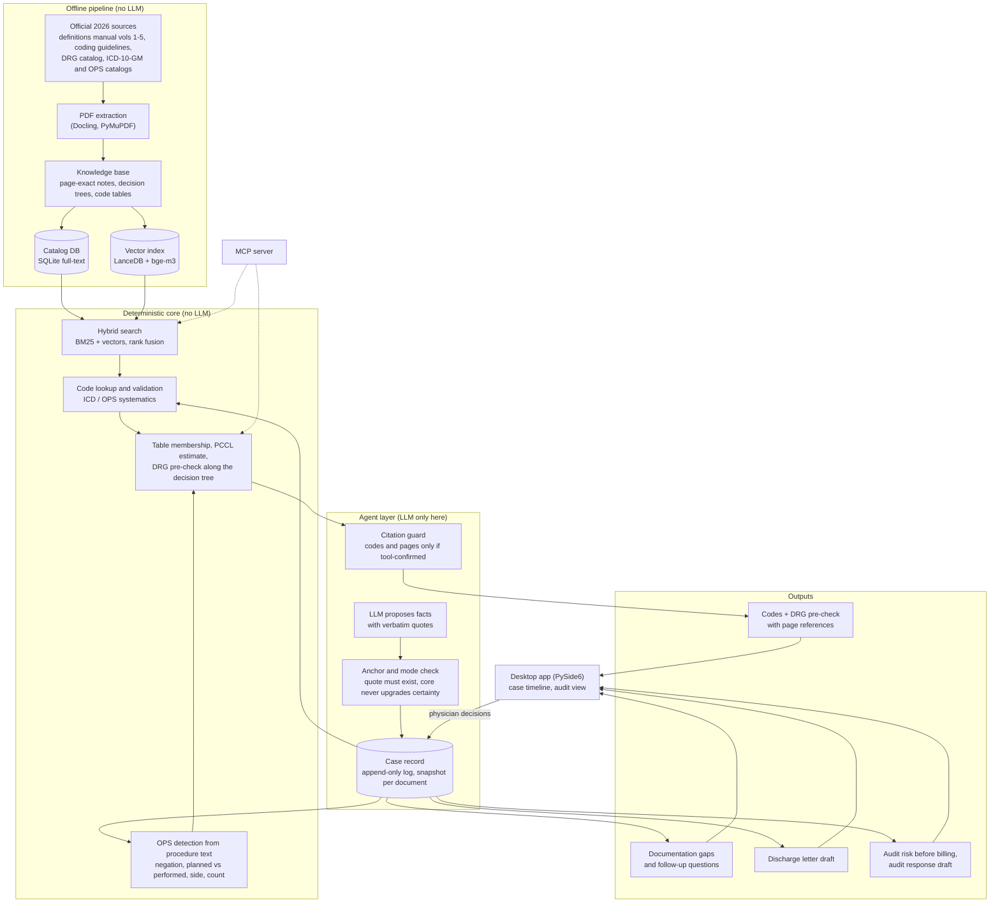

# Kowalski

An AI coding assistant for German hospitals: it turns clinical documentation into ICD-10-GM diagnoses, OPS procedures and a DRG pre-check, and backs every code with a page reference to the official 2026 rulebooks.

> **Source is private; this repo is a showcase.** Kowalski is an early-stage venture that is not public yet. This page explains what it does, how it works and how it was built. No source code, no knowledge base content, no screenshots. All examples are synthetic and written for this page.

**Scope today:** German aG-DRG system, version 2026, with vascular surgery as the core specialty. Synthetic and mock cases only; no real patient data has ever been used.

## Why

German hospitals are paid per case through DRGs (diagnosis-related groups). The DRG is determined by the coded diagnoses and procedures, and the rules for that fill five volumes of definitions manual, a set of coding guidelines and several official catalogs. Coding is largely manual work, usually done after discharge, and the insurers' medical review service (MD) audits a share of the bills. An audit asks one question: is every code backed by the documentation?

An assistant that guesses a plausible code is worse than none. So Kowalski is built around one rule: **no invented codes. Better "not found" than a plausible wrong answer.**

## What it does

**Coding assistant.** Given a case, Kowalski proposes the principal diagnosis, secondary diagnoses and OPS procedure codes, then runs a DRG pre-check. Every code and every page number it outputs must have been confirmed by a tool call against the official catalogs or manuals in the same session. Anything unconfirmed is flagged, never silently dropped. When a detail that decides a sub-code is missing from the text, it asks the physician instead of picking one.

**Case platform (in progress).** Since October 2026 Kowalski is being reworked from a one-shot coding tool into a case platform: one case record that grows from admission to discharge.

- Every clinical fact points to the exact sentence it came from (document, section, character range, verbatim quote).
- Coding, documentation gaps, a discharge letter draft and an audit-risk view all read from that one record.
- Before billing, Kowalski rates how well each coded item is backed ("evidence present / thin / missing").
- If an audit comes in, it matches the auditor's objections against the evidence that existed before billing and drafts a structured response. The physician makes the final call.

### Worked example (synthetic)

**Input:** a short synthetic note. *"Elective admission for claudication of the left leg, walking distance under 200 m. Known hypertension. Day 2: balloon angioplasty of the left superficial femoral artery and placement of one bare-metal stent."*

**What happens:**

1. The agent layer reads the note and proposes facts, each with a quote. The deterministic core accepts a fact only if its quote appears verbatim in the note, and checks its mode: a suspected, negated or planned finding is never recorded as confirmed.
2. The coding chain looks up candidates in the official catalogs and confirms each code with its official title.
3. The DRG pre-check derives the major diagnostic category, walks the grouper decision tree from the definitions manual and lists candidate DRGs with cost weight and length-of-stay limits from the DRG catalog.

**Output (shape, page numbers omitted here):**

| Item | Proposal | Evidence |
|---|---|---|
| Principal diagnosis | I70.22, atherosclerosis of the limb arteries, pelvis-leg type, exertional ischemic pain, walking distance under 200 m | ICD-10-GM 2026 catalog entry; quote "claudication ... walking distance under 200 m" |
| Secondary diagnosis | I10.00, essential hypertension | ICD-10-GM 2026 catalog entry; quote "Known hypertension" |
| Procedure | 8-836.0s, balloon angioplasty, thigh arteries | OPS 2026 catalog entry; quote from the day 2 sentence |
| Procedure | 8-840.0s, one non-drug-eluting stent, thigh arteries | OPS 2026 catalog entry; "one" is stated in the text, so the stent-count axis is covered |
| DRG pre-check | MDC 05 (circulatory system), base DRG F59 (moderately complex vascular procedures); final split open | Definitions manual vol. 1, decision tree pages; DRG catalog page for each candidate |

If the note had said "stent placed" without a count, Kowalski would not pick a sub-code. It would ask: *"How many stents were implanted?"*

**What it does not claim:** the DRG result is a pre-check, not a certified grouper result. It stays marked as open until checked against one. No euro amount is shown without a verified price source.

## How it works

The system has a hard boundary: **the pipeline, the knowledge base and retrieval are fully deterministic and make no LLM calls.** An LLM is used only in the agent layer, to read free text and propose facts. Everything that decides something (anchoring, mode checks, coding chain, DRG pre-check, evidence levels, audit matching) is deterministic Python and reproducible: replaying the synthetic end-to-end case gives byte-identical output.

The same core is exposed two ways: as a Python library for the agent and the desktop app, and as an MCP server so Claude Code can use the knowledge base as tools during development and evaluation.

## How it was built

I build by directing AI coding agents. I write the specs, break the work into packages, set the rules the agents work under and decide what gets merged. **Claude Code (and occasionally Codex) wrote the code.** My job is to make sure what they produce is correct, which in medical coding is the hard part.

| | |
|---|---|
| Started | 2 September 2026 |
| Commits | 1,514 on the development branch |
| Merged pull requests | 250 |
| Automated tests | 5,000+ test functions in 8 suites (core, agent, app, eval, benchmark, pipeline, retrieval, end-to-end case) |
| Size | ~200,000 lines of Python, about 40% of it tests |

*As of 31 October 2026.*

**How the agents work:**

- **Parallel lanes in the cloud.** A coordinator session plans each wave of work and hands self-contained packages to parallel Claude Code agents running in the cloud. Each lane owns one area (OPS detection, follow-up questions, grouper logic, benchmarks, telemetry) and works on its own branch. Everything lands as a pull request on an integration branch; nobody pushes to `main`.
- **Spec before code.** Larger changes start as a written spec. The case platform spec went through three review rounds and was approved before any code was written for it.
- **Shared rules for every agent.** `CLAUDE.md` and `AGENTS.md` give Claude Code and Codex the same hard constraints: no LLM calls in pipeline, retrieval or tests; mock cases only; no paid API runs without explicit approval; no force-push.
- **Project-specific agent skills.** Prompting skills per model define how the coordinator briefs sub-agents (task skeleton, what to cut, how to ask a reviewer for full coverage), plus model routing per task type. A dedicated coding agent definition can only use the knowledge-base tools.

**Verification gates:**

1. **Independent review per PR.** Every pull request is reviewed by a separate agent and re-tested in a fresh worktree. Review findings become their own follow-up PRs, so a large share of the 250 PRs are fixes to findings from earlier reviews.
2. **Known-red baseline in the cloud.** Cloud agents only have a small data package. Tests that need the full 1.4 GB knowledge base are on a fixed expected-red list, so a new failure stands out.
3. **Full local check before `main`.** Before anything reaches `main`, I run every suite on my Mac with the full data package. A small Claude Code plugin (agent-built as well) runs the tests and the decision-tree oracle for a PR against its base in one command.
4. **Invariant tests.** Rules like "a code from an unapproved draft rule is never marked confirmed without a physician's choice" are tests, and some tests are hardened against mutants.
5. **Fail-closed metrics.** The main quality metric for OPS detection is zero false "unambiguous" answers on held-out synthetic sets. Recall is tracked, and blind sets are never tuned against.
6. **Pitfalls log.** Every PR records environment pitfalls it hit (missing system libraries in containers, offline model caches, merge conflicts on generated manifests). They are appended to a shared log so the next agent doesn't hit them again.

## Tech stack

- **Language and tooling:** Python 3.12, uv
- **Extraction:** Docling, PyMuPDF
- **Search:** SQLite full-text catalog, LanceDB with sentence-transformers (BAAI bge-m3), BM25 (bm25s), reciprocal rank fusion
- **Agent:** Anthropic Claude API, agent layer only; a local-model adapter behind the same interface is planned
- **Tools interface:** MCP server (FastMCP)
- **App:** PySide6 desktop app (macOS and Windows)
- **Case record:** SQLite with optimistic locking, append-only event log, per-document snapshots
- **Tests:** unittest, 8 suites, deterministic replay of LLM responses

## Status and roadmap

**Done (September to October 2026)**

- Knowledge base built from the official 2026 manuals and catalogs, with page-exact references
- Deterministic retrieval and coding core, MCP server, desktop app
- Case platform v0: document-anchored facts, coding chain from the case record, documentation gaps, discharge letter draft, audit risk before billing, audit response draft
- One synthetic case runs end-to-end from admission to audit response in one command, byte-identical in replay

**Now**

- Hardening how procedure text is read: negation, planned vs performed, left vs right, counts
- Clinical review of draft coding rules; until a rule is approved, its codes stay "suggestion"

**Next**

- Compare DRG results against a certified grouper
- Local model option so clinical text never has to leave the hospital
- Evaluation on clinician-annotated synthetic gold cases

## Contact

Pano · [x.com/panootw](https://x.com/panootw)
